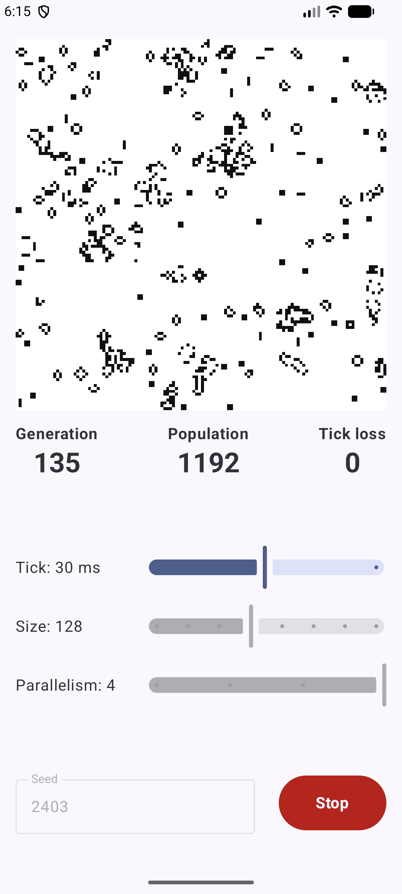

# Game of Life

Conway's Game of Life for Android, built as a producer-consumer problem with Kotlin coroutines.

## Coroutines Aspects of Project
#### **Producer**
`TickSource` emits ticks at the rate set by the user. It runs in the application-lasting `@ApplicationScope`, so the ticker outlives the screen and stops 5s after
  the last collector leaves (practically, only one collector). It never waits for the simulation: `buffer(1, DROP_OLDEST)` keeps
  only the newest tick. Ticks that arrive while a step is still computing are dropped and shown
  as **Tick loss** in the UI.

#### Consumer 
Simulation logic is kept in `SimulationRepository.run` where ticks are collected.
It runs on `Dispatchers.Default.limitedParallelism(parallelism)` so grid chunks are computed in parallel. `Grid.next(chunks)` splits the rows into chunks and launches one coroutine per chunk. No locks or synchronization are needed since every coroutine updates only its own rows of the next grid.
#### Rendering
View model turns each grid into a bitmap on `Dispatchers.Default`.

#### Cancellation
Clicking stop cancels the run's job, which cancels the tick collection and any pending chunks calculations.

---
_App created as a final project for Kotlin Coroutines Mastery course made by [kt.academy](https://kt.academy/), big thanks for Marcin Moskała for excellent learning program_